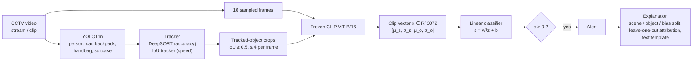

<div align="center">

# Explainable Surveillance Video Anomaly Detection

### Tracked-object evidence and frozen CLIP features, evaluated without scene leakage

[](https://www.python.org/)
[](https://pytorch.org/)
[](https://docs.ultralytics.com/)
[](https://github.com/openai/CLIP)
[](#datasets)
[](LICENSE)
[](#release-status)

**Chayan Mondal Abir** · **G. Balamurugan**
Department of Computer Science and Engineering / Department of Computing Technologies,
SRM Institute of Science and Technology, Kattankulathur, Tamil Nadu, India

</div>

---

## Release status

> **This README is published first. Code, figures and result files will be added after the accompanying paper is published.**
> Everything below describes the method and the reported results so that the work can be understood on its own; the full source is released with the paper.

| Component | Status |
|---|---|
| README, method description, results summary | Available now |
| Pipeline source code (detection, tracking, features, classifier, explanations, benchmarks) | Released after publication |
| Figure scripts and result tables (CSV) | Released after publication |
| Paper link and citation (DOI) | Added after publication |

---

## Overview

Surveillance networks record far more video than security staff can follow. Automatic detectors that flag events such as violence, theft, abandoned baggage or intrusion are therefore needed, but two problems limit their use in practice:

1. **Optimistic evaluation.** Many reported detectors are scored on random splits in which frames or near-duplicate clips of the same scene appear on both sides of the split. The model can then succeed by recognising the *scene* instead of the *behaviour*.
2. **Opaque decisions.** An operator who receives an alert needs to see *why* it was raised, and the explanation must be shown to follow the model rather than merely look plausible.

This project builds a clip-level anomaly detector whose score **decomposes exactly into scene evidence, tracked-object evidence and a bias term**, and evaluates it with **whole scenes held out** and with a **leakage and shortcut audit**.

### Main findings

- **The evaluation protocol matters more than the model.** The same ViT-B scene features reach **93.0 %** accuracy under a random split of ShanghaiTech but only **54.4 %** when scenes are held out, below the 77.9 % majority-class rate.
- **Frozen CLIP ViT-B/16 generalises to unseen scenes** far better than ViT-B, DINOv2 or MobileNetV2 features: AUC **0.960** on ShanghaiTech (leave-one-scene-out) and **0.987** on a 340-clip UCF-Crime subset (grouped cross-validation).
- **The explanations are faithful in a deletion test.** Removing the objects the attribution ranks highest lowers the alert score by **3.84 logits**, against 1.32 for random removal; 76 % of alerts flip when 20 % of the crops are removed, against 27 % for random removal. Grad-CAM disagrees with this ranking.
- **It runs faster than real time on one GPU.** With an IoU tracker and a frame stride of 2, the AUC stays at **0.958** at a real-time factor of **0.17** (Tesla T4, 30 fps, one stream).

---

## Pipeline



**Perception.** YOLO11n (COCO weights, not fine-tuned, confidence 0.25) detects five object classes. DeepSORT (max age 30) is the accuracy reference; a lightweight greedy IoU tracker (IoU 0.3, 3 hits, max age 30 processed frames) is the speed option. Both can run on every *k*-th frame, *k* ∈ {1, 2, 4, 8}.

**Encoding.** Sixteen frames per clip and the crops of tracked objects are embedded by one frozen CLIP ViT-B/16 (768-d). Frame and crop embeddings are pooled to mean and standard deviation, giving a 3072-d clip vector **x** = [μ<sub>s</sub>, σ<sub>s</sub>, μ<sub>o</sub>, σ<sub>o</sub>].

**Decision.** A standardised, class-balanced logistic regression (C ∈ {0.001, 0.01, 0.1}, chosen by inner 3-fold grouped cross-validation) gives a score *s* = **w**ᵀ**z** + *b*. A clip is flagged as anomalous when *s* > 0. Because the model is linear, the score splits **exactly** into a scene term, an object term and a bias.

**Explanation.** For every alert the system reports (i) the exact scene / object / bias split of the score, (ii) a leave-one-out attribution Δ*e* for each crop, track and frame, and (iii) a short text template naming the most influential objects and frames. Grad-CAM is computed only as a comparison.

**Training for robustness.** Training uses edit augmentation (black bars, a synthetic timestamp, and a border strip for UCF-Crime) so that the model does not rely on non-content cues.

---

## Evaluation protocol

| | UCF-Crime subset | ShanghaiTech |
|---|:---:|:---:|
| Clips | 340 | 199 |
| Normal / anomalous | 80 / 260 | 155 / 44 |
| Majority-class accuracy | 0.765 | 0.779 |
| Protocol | grouped 5-fold CV | leave-one-scene-out |
| Evaluation groups | 333 near-duplicate groups | 13 scenes |

- **UCF-Crime:** 340 hand-trimmed clips (13 anomaly classes × 20 clips, plus 80 normal). Clips whose mean CLIP frame embeddings have cosine similarity above 0.97 are merged into one group (333 groups) and never split across folds (`StratifiedGroupKFold`, 5 folds, seed 42).
- **ShanghaiTech:** the 199-video test split of the Zhong *et al.* (CVPR 2019) reorganisation, evaluated by leaving one of the 13 scenes out at a time.
- **Metrics:** AUC of the pooled out-of-fold scores and balanced accuracy at the fixed threshold *s* = 0. Uncertainty is given as 95 % confidence intervals from a cluster bootstrap (1000 resamples).

---

## Results

All values are taken from the manuscript. Frame-level AUCs published for these datasets use other protocols; **the numbers below are clip-level and are not directly comparable with them.**

### Final model

| Dataset | AUC | Balanced accuracy |
|---|:---:|:---:|
| ShanghaiTech (unseen scenes) | **0.960** | 0.878 |
| UCF-Crime subset (grouped CV) | **0.987** | 0.939 |

### Effect of the evaluation protocol (ViT-B scene features)

| Dataset | Split | Accuracy | AUC |
|---|---|:---:|:---:|
| ShanghaiTech | random | 93.0 % | 0.956 |
| ShanghaiTech | scenes held out | **54.4 %** | 0.630 |
| UCF-Crime | random | 90.6 % | 0.954 |
| UCF-Crime | duplicate groups held out | 90.0 % | 0.947 |

### Backbone comparison (AUC)

| Backbone | Params (M) | ShanghaiTech: scene | crops | both | UCF-Crime: scene | crops | both |
|---|:---:|:---:|:---:|:---:|:---:|:---:|:---:|
| ViT-B (in21k) | 86.4 | 0.749 | 0.892 | 0.876 | 0.942 | 0.965 | 0.967 |
| DINOv2-B | 86.6 | 0.724 | 0.880 | 0.863 | 0.940 | 0.924 | 0.949 |
| **CLIP ViT-B/16** | 85.8 | **0.936** | **0.944** | **0.959** | **0.984** | 0.952 | **0.982** |
| MobileNetV2 | 2.2 | 0.655 | 0.742 | 0.743 | 0.935 | 0.928 | 0.947 |

For CLIP, adding crops does **not** significantly raise accuracy (ShanghaiTech +0.024, 95 % CI −0.002 to 0.057). The crops are kept because they supply the object-level evidence for the explanations and make the predictions less sensitive to frame edits.

### Robustness to non-content edits (ShanghaiTech, trained on unedited frames)

| Features | Predictions changed: bars | timestamp | AUC: clean | bars | timestamp |
|---|:---:|:---:|:---:|:---:|:---:|
| CLIP scene only | 33.7 % | 19.6 % | 0.936 | 0.844 | 0.906 |
| CLIP scene + crops | 9.5 % | 9.0 % | 0.959 | 0.941 | 0.962 |

A probe that sees only border and resolution information reaches an AUC of 0.72 on UCF-Crime (262 of the 340 clips have black borders) and 0.35 on ShanghaiTech, so UCF-Crime contains a usable non-content shortcut and ShanghaiTech does not.

### Explanation quality: deletion test on alerted clips

Mean confidence drop in logits (averaged over 10–50 % of crops removed); flips = alerts that change to normal when 20 % / 50 % of the crops are removed.

| Ordering | ShanghaiTech drop | flips | UCF-Crime drop | flips |
|---|:---:|:---:|:---:|:---:|
| **Proposed attribution** | **3.84** | **76 / 93 %** | **0.74** | 2 / 3 % |
| Random | 1.32 | 27 / 59 % | −0.09 | 0 / 0 % |
| Box size | 0.99 | 27 / 41 % | 0.12 | 0 / 0 % |
| Detector confidence | 1.57 | 37 / 63 % | −0.08 | 0 / 0 % |
| Least important first | −1.58 | 0 / 2 % | −0.86 | 0 / 0 % |

On ShanghaiTech, tracked objects carry 58 % of the absolute scene-plus-object evidence; on UCF-Crime the scene dominates (objects 36 %), so objects change few decisions there. Generating an explanation takes 30–40 ms per clip on a CPU.

### Speed and accuracy (ShanghaiTech, Tesla T4, 199 clips)

| Tracker | Stride | AUC (95 % CI) | ms / source frame | RTF @ 30 fps |
|---|:---:|:---:|:---:|:---:|
| DeepSORT | 1 | 0.959 (0.915–0.986) | 65.8 | 1.97 |
| DeepSORT | 2 | 0.958 (0.919–0.985) | 27.6 | 0.83 |
| DeepSORT | 4 | 0.946 (0.887–0.981) | 11.0 | 0.33 |
| IoU | 1 | 0.958 (0.920–0.988) | 10.6 | 0.32 |
| **IoU** | **2** | **0.958 (0.915–0.987)** | **5.5** | **0.17** |
| IoU | 4 | 0.940 (0.892–0.979) | 2.9 | 0.09 |
| IoU | 8 | 0.903 (0.820–0.963) | 1.6 | 0.05 |

RTF below 1 means faster than real time. The recommended real-time configuration is **YOLO11n + IoU tracker at stride 2**; DeepSORT at stride 1 is the accuracy reference. The balanced accuracy at the fixed threshold drops from 0.852 to about 0.79 at stride 2 while the AUC does not, so the threshold should be recalibrated for each configuration.

---

## Hardware and software

| Item | Setting |
|---|---|
| GPU machine | Kaggle, NVIDIA Tesla T4, fp16 encoders |
| Laptop | MacBook Air M4, MPS, fp32 |
| Software | Python, PyTorch, Ultralytics (YOLO11), deep-sort-realtime, Hugging Face Transformers, scikit-learn |

---

## Repository layout (released with the paper)

```text
.
├── README.md
├── LICENSE                     MIT
├── CITATION.cff
├── requirements.txt
├── scripts/                    numbered pipeline steps
│   ├── step1_detect_ucf.py         YOLO11n detections for UCF-Crime clips
│   ├── step2_track_ucf.py          DeepSORT tracks
│   ├── step3e_robust_training.py   edit-augmented classifier training
│   ├── step4a_extract_parts.py     per-frame / per-crop CLIP embeddings, boxes, track ids
│   ├── step4b_explain.py           final model, explanations, deletion tests
│   ├── step4c_gradcam.py           Grad-CAM comparison
│   ├── step5a_benchmark.py         per-stage latency (T4 / M4)
│   ├── step5b_speed_accuracy.py    tracker × stride trade-off
│   └── step5c_benchmark_iou_stride.py   IoU-tracker benchmark on a laptop
├── figures/                    paper figures and the scripts that draw them
├── results/tables/             result tables as CSV
├── docs/                       reproduction order, dataset preparation
└── tools/list_clips.py         dataset manifest generator
```

---

## Datasets

The datasets are **not** redistributed. Obtain them from their original sources and follow their licences.

- **UCF-Crime** — Sultani, Chen and Shah, *Real-world anomaly detection in surveillance videos*, CVPR 2018.
- **ShanghaiTech Campus** — test-split reorganisation of Zhong *et al.*, *Graph convolutional label noise cleaner*, CVPR 2019.

Expected layout:

```text
$DATA_ROOT/
├── UCF-Crime/UCF-Crime/<class>/*.mp4
└── ShanghaiTech/SHANGHAI/SHANGHAI_Test/{frames/…, SHANGHAI_test.txt}
```

---

## Getting started (once the code is released)

```bash
git clone <this-repository>
cd <this-repository>
python -m venv .venv && source .venv/bin/activate
pip install -r requirements.txt

export DATA_ROOT=/path/to/datasets   # see "Datasets"
export RUN_ROOT=./runs               # intermediate outputs of every step

python scripts/step1_detect_ucf.py
python scripts/step2_track_ucf.py
# ... continue in the order given in docs/REPRODUCING.md
```

A CUDA GPU is recommended for the feature-extraction and Grad-CAM steps (`step4a`, `step4c`); the classifier and explanation steps (`step3e`, `step4b`) run on a CPU.

---

## Limitations

- The UCF-Crime evaluation uses a hand-curated 340-clip subset; its event-centred trimming makes the task easier than detection in untrimmed video.
- The 199-video ShanghaiTech split has only 44 abnormal clips, so confidence intervals are wide.
- Labels are clip-level: events are **not localised in time**.
- A classifier trained on UCF-Crime does **not** transfer to ShanghaiTech (AUC 0.31–0.69 across encoders), so no claim is made about cross-dataset generalisation.
- All encoders are frozen and the COCO detector is not fine-tuned.
- The IoU tracker was validated only on static cameras and is not claimed to suffice for fast or crowded scenes.
- The real-time factor measures throughput, **not alert delay** (a decision needs a complete 16-frame window), and the explanation cost is not included.
- The laptop is not an embedded device; the M4 timings only indicate feasibility.
- The deletion test shifts the input, so it supports relative comparisons only.

---

## Responsible use

This is a research prototype evaluated on public benchmark data. It is **not** a validated security product. Automated alerts can be wrong (false alarms and misses are shown in the paper) and should be reviewed by a human operator. Deployment on real people's video raises privacy, consent and fairness questions that this work does not address; follow local law and institutional policy.

---

## Citation

The paper is in preparation. Until a DOI is available, please cite the repository:

```bibtex
@misc{abir2026explainable,
  title  = {Explainable Surveillance Video Anomaly Detection Using Tracked-Object Evidence
            and Frozen CLIP Features with Leakage-Aware Evaluation},
  author = {Abir, Chayan Mondal and Balamurugan, G.},
  year   = {2026},
  note   = {Code and results to be released with the paper}
}
```

This section will be updated with the full reference after publication.

---

## Contact

Corresponding author: G. Balamurugan — balamurg1@srmist.edu.in
For questions about the code, please open an issue once the repository is public.

## Acknowledgements

The authors thank the Department of Computing Technologies, SRM Institute of Science and Technology, for academic support. No external funding was received for this work. An AI assistant (Claude, Anthropic) helped write and debug the experiment code and improve the language of the manuscript; the authors designed the study, ran all experiments and take full responsibility for the content.

## License

Released under the [MIT License](LICENSE). The datasets and pretrained models (YOLO11, CLIP, DeepSORT embedder) keep their own licences; note in particular that Ultralytics YOLO is distributed under AGPL-3.0.
